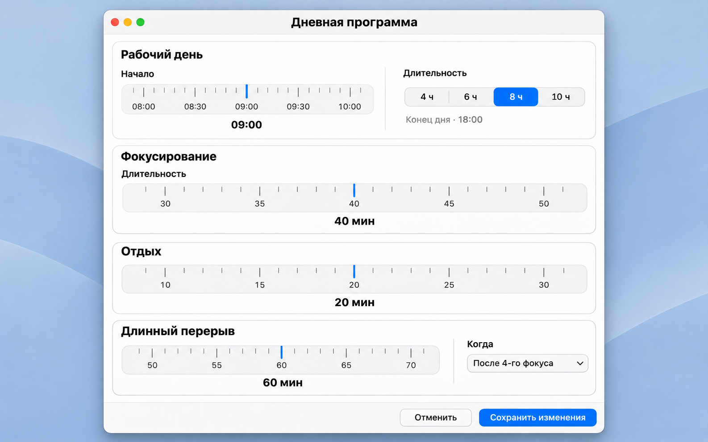

# Workday Rhythm

Workday Rhythm — серийный таймер для macOS, который помогает чередовать фокусирование на работе и отдых в течение всего рабочего дня.

## Какую проблему решает

Разработчик может использовать таймер, чтобы чередовать интервалы сосредоточенной работы и отдыха. Но стоит один раз остановить таймер — и легко забыть запустить новый цикл. Запланированный ритм работы и перерывов теряется.

Workday Rhythm решает эту проблему: таймер настраивается сразу на весь рабочий день. Пользователь задаёт начало и длительность дня, интервалы фокусирования, обычные и длинные перерывы. Все интервалы входят в одну последовательную программу, поэтому каждый цикл не нужно настраивать заново.

Приложение задумано как таймер в строке меню: оно чередует работу и отдых, сообщает о завершении интервала звуком и экранным сигналом. После отдыха следующий интервал фокусирования начинается с подтверждения пользователя. Настройки дневной программы открываются в отдельном окне.

*Окно настройки дневной программы: начало рабочего дня, фокусирование, отдых и длинный перерыв.*

## Состояние проекта

Работает дневной таймер в строке меню: команды меняются вместе с состоянием — «Начать день», «Пауза», «Продолжить работу» или «Продолжить» после отдыха. После завершения отдыха следующий интервал фокусирования начинается только после подтверждения. Когда следующий полный интервал не помещается до вычисленного конца дня, приложение остаётся в строке меню без активного таймера; в новом календарном дне сохранённую программу можно начать заново.

«Настройки» открывают отдельное окно с панелью «Рабочий день». В нём сохраняются начало и длительность дня, длительности фокусирования и отдыха, а также один длинный перерыв. Сохранение немедленно применяет допустимую программу к текущей сессии и закрывает окно; отмена закрывает окно без сохранения черновика. Высота окна подстраивается под полное содержимое и ограничена половиной высоты доступного экрана. При будущем переполнении прокручивается только область полей, а кнопки действий остаются видимыми.

Сон Mac не завершает сессию: после пробуждения таймер учитывает прошедшее время и показывает только актуальный следующий этап. Выход завершает текущую сессию без восстановления при следующем запуске, но сохраняет параметры программы. Настраиваемые сигналы и дополнительные панели настроек находятся в отдельной разработке. Минимальная версия системы — macOS 13.

## Тесты

После подготовки Xcode по [инструкции разработки](docs/development.md) запускайте локальную проверку через `just check`.
Она включает линтер, проверку имён, сборку и XCTest без запуска приложения:
проверки графа модулей и импортов находятся в `Tests/ArchitectureTests/`,
а сценарии программы и сессии — в targets `ProgramTests`, `TimerEngineTests` и `SessionCoordinatorTests`.
Для исправления форматирования служит `just fmt`. Требуются полный Xcode 26.6 со Swift 6.3.3
и `just` 1.59.0, устанавливаемый через Homebrew. Точные команды установки, запуска и
настройки кешей для ограниченного окружения находятся только в инструкции разработки.

## Документация

- [Разработка](docs/development.md) — требования, первые шаги, сборка и запуск.
- [Тестирование](docs/testing.md) — правила тестов, покрытие и ручные проверки.
- [Стиль Swift](docs/code-style.md) — оформление, имена и API.
- [Архитектура](docs/architecture.md) — компоненты, зависимости и владение.
- [Инструкции для агентов](AGENTS.md) — порядок работы с проектом.
