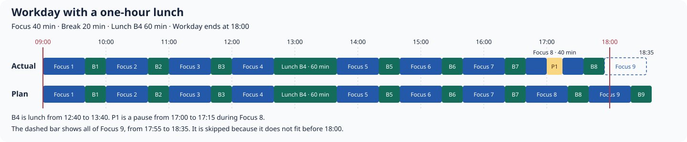

# План и факт дневной программы

Горизонтальный SVG показывает факт сверху и план снизу на общей шкале с границами рабочего дня 09:00 и 18:00. Подписи SVG на английском. О4 — часовой обед. У работы, отдыха и пауз собственная последовательная нумерация.

Пауза сдвигает расписание, сохраняя настроенные длительности работы и отдыха. Не поместившийся интервал показан целиком пунктиром за 18:00 и пропускается. Ожидание «Продолжить» действует на последующие окна аналогично задержке, сохраняя полную длительность следующей работы.

Настройки хранятся через UserDefaults и применяются после сохранения сразу. Сон засчитывается, а после пропущенных границ показывается один актуальный сигнал. Ручной перевод часов сохраняет оставшуюся длительность текущего интервала и пересчитывает календарные границы.

Конец дня фиксирован. Уже начатая работа может завершиться позже. Когда следующая работа не помещается, приложение остаётся в фоне без запуска таймеров. В новом дне первое из событий активности на Mac или 09:00 вызывает предложение начать день. При сне в 09:00 предложение появляется после пробуждения. Запуск работы требует подтверждения.

Нормативные сценарии находятся в [timer-cycle](../timer-cycle/spec.md), [daily-program](spec.md) и [timer-alerts](../timer-alerts/spec.md).
